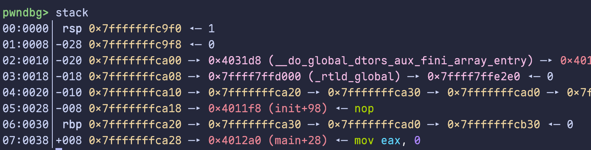
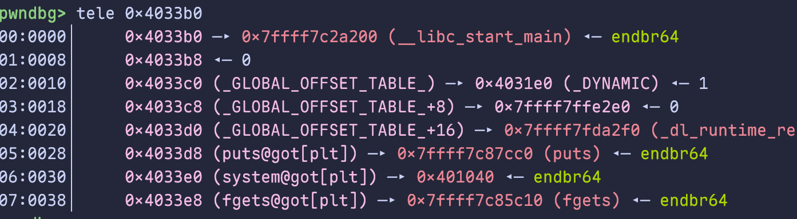

# 如何使用 GDB + pwndbg 调试

> 本文介绍基于 gdb + pwndbg 的程序调试方法，以及配合 pwntools 进行联动调试的技巧。

在开始前请检查你的 gdb 是否正确加载了 pwndbg：启动后应该能看到 `pwndbg>` 输入提示符。为了简略，本文均省略 `pwndbg>` 提示符。

## 启动、运行、断点

启动调试程序：

```bash
gdb ./pwn
```

或者先启动 gdb，再用 `file` 载入目标：

```bash
gdb
```

启动后输入 `file <文件名>`。

设置断点的几种方式：按地址下断点、按函数名下断点、简写，以及开启 PIE 后的常用方式。

```bash
break *0x404000
break main
b main

break *$rebase(0x1FD8)
```

开始运行：

```bash
run
r
```

运行至断点：

```bash
continue
c
```

单步执行，步入（step into），会进入函数内部逐条执行：

```bash
step
s
```

单步执行，步过（step over），遇到函数调用直接执行完，不进入内部：

```bash
next
n
```

单步执行，步入一条机器指令（汇编级），用于底层调试：

```bash
stepi
si
```

单步执行，步过一条机器指令（汇编级）：

```bash
nexti
ni
```

## 高级命令

查看当前栈上信息，可以查看当前栈上的数据和指针：按照 8 字节一组，显示 rbp 和 rsp 指向哪里。下图中可以看到，其中 `-008` 等是与 rbp 的相对偏移，还可以看到 `rbp+8` 的位置是返回地址。

```bash
stack
```



默认只显示一部分，想多看几行可以指定数量：

```bash
stack 20
```

查看堆信息：

```bash
heap
```

可视化堆 chunk 布局：

```bash
vis-heap-chunks
vis
```

查看 bin 信息：

```bash
bins
```

查看 `PLT` 表和 `GOT` 表：

```bash
plt
got
```

反汇编某段内存：

```bash
disassemble main
disassemble 0x40122e
```

查看段信息：

```bash
vmmap
```

查看任意地址的内存，如下图：

```bash
tele 0x7fffffffda20
```



查看 PIE 基址、canary、libc 偏移：

```bash
pie
canary
libc
```

## 与 pwntools 联动调试

你是否经常遇到 exp 触发了程序异常、却没拿到 shell，而且不知道到底是哪一步出了问题？gdb 与 pwntools 的联动调试可以帮助我们窥探 exp 运行时目标程序的内存，以下是笔者常用的调试方式：

```python
from pwn import *
context(arch='amd64', log_level='debug', os='linux')
# context.terminal = ['tmux', 'new-window']

io = process('./pwn')
sc = '''break *0x404040
c
'''
gdb.attach(io, sc)

# exp 的内容...

io.interactive()
```

这样一来，当 exp 执行到 `gdb.attach(io, sc)` 的时候，就会弹出一个新的终端窗口，也就是 gdb 的调试界面。根据 `sc` 的内容，它会在 `0x404040`（示范地址）下断点，并运行到这个地方。

如果程序开启了 PIE，每次运行的地址都不同，原来的 `0x404040` 固定地址就失效了，可以用 `brva 0x1010`（`breakrva` 的简写）或 `break *$rebase(0x1010)` 这种方式来代替。注意 `brva` 后面不写 `*`，它接收的是偏移量，不是解引用。

如果没有弹出新的终端窗口，那可能是**卡住了**：可以在运行 exp 前先手动开启一个终端，输入 `tmux` 并运行。一般的发行版都预装了 tmux，它是一个终端复用器。之后在 exp 中添加 `context.terminal = ['tmux', 'new-window']` 这一行*（虽然我现在注释掉了）*，这样运行 exp 后，就可以在 tmux 窗口中看到 gdb 调试界面。

初次使用 tmux 可能不太习惯。如果需要启用鼠标（比如滚动功能），需要按 `ctrl+b` 后输入 `:set -g mouse on`；想退出 tmux 就先按 `ctrl+b` 再按 `d`。

## 结语

以上就是笔者个人常用的 gdb 调试技巧。这些虽然足够应付日常调试，但 gdb 的技巧远不止这些，欢迎提问和补充！
